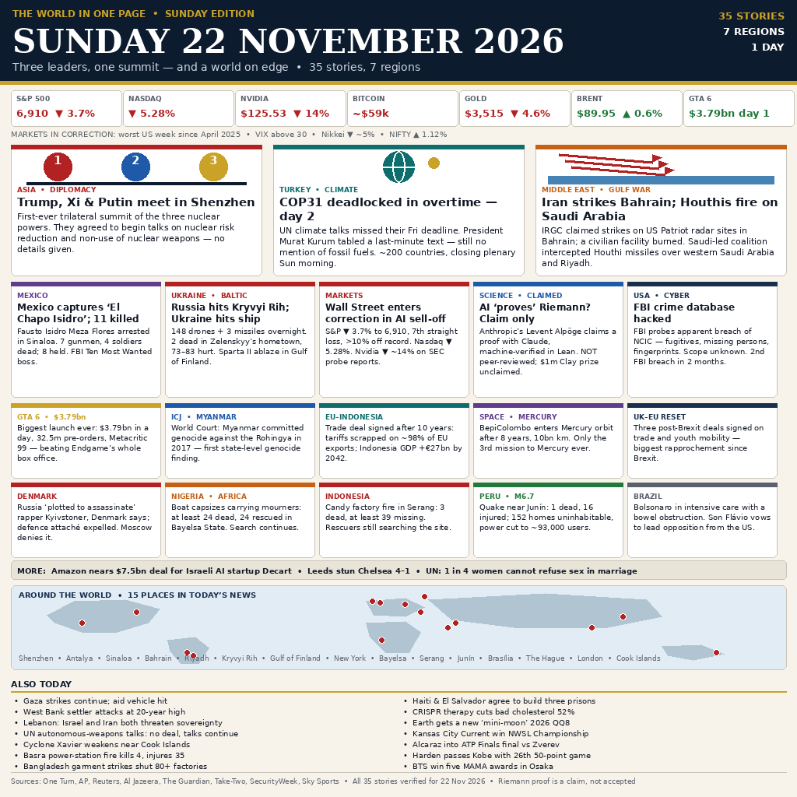

# news-image-20261122 — Sunday 22 November 2026 in one image

[](https://make.fun/bounty/news-image-20261122)
[](https://make.fun/bounty/news-image-20261122)
[](https://make.fun/bounty/news-image-20261122)

One image summing up the world's news of Sunday 22 November 2026: the first-ever
Trump–Xi–Putin summit in Shenzhen, COP31 deadlocked in a second day of overtime,
the Gulf war escalating across Bahrain and Saudi Arabia, Wall Street entering
correction in an AI sell-off, the claimed AI proof of the Riemann hypothesis, and
30 more verified stories across 7 regions — 35 stories in one 1024×1024 page.

## The image



## How it was made

`entry.png` was rendered from a research brief of 35 stories verified for
22 November 2026 (see the build session), with a masthead, a market KPI strip,
three lead stories, five more lead cards, ten regional cards, a world map with
15 story pins, and an "ALSO TODAY" list of 14 more stories.

## Run

```sh
mkdir -p out && MAKEFUN_OUTPUT_DIR=out python3 main.py
```

`main.py` is standard library only: it copies `entry.png` to
`$MAKEFUN_OUTPUT_DIR/entry.png`, byte-identical on every run.

## Bounty

Entry for [Sum up 22 November's world news in one image](https://make.fun/bounty/news-image-20261122)
on [make.fun](https://make.fun) — $100, top 50 share the prize.

## License

MIT — see [LICENSE](LICENSE).
